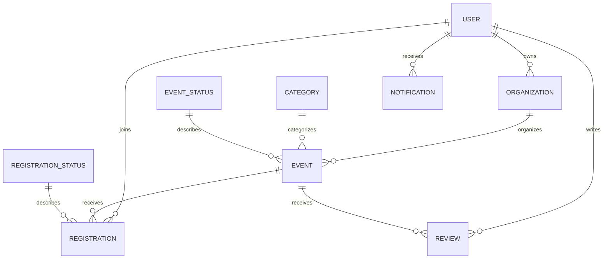

# Database бүтэц

`zur.jpg` загварыг Django model, migration-аар хэрэгжүүлсэн. Үндсэн database нь PostgreSQL.

| Зураг | Database хүснэгт | Гол талбарууд |
|---|---|---|
| Хэрэглэгч | accounts_user | id, last_name (овог), name (нэр), email, phone, password (hash), birth_date, date_joined |
| Байгууллага | events_organization | id, owner_id, name, description, contact_email, is_verified |
| Ангилал | events_category | id, name |
| Арга хэмжээний төлөв | events_eventstatus | id, name |
| Арга хэмжээ | argahemjee | дугаар, байгууллага, ангилал, төлөв, гарчиг, тайлбар, байршил, эхлэх/дуусах огноо, багтаамж |
| Бүртгэлийн төлөв | events_registrationstatus | id, name |
| Бүртгэл | events_eventregistration | id, user_id, event_id, status_id, attended, worked_hours, created_at |
| Үнэлгээ | events_review | id, user_id, event_id, score, comment |
| Мэдэгдэл | events_notification | id, user_id, content, is_read, sent_at |

AuthToken болон Django-ийн эрх, migration-ийн туслах хүснэгтүүд мөн бий.
Үнэлгээ, мэдэгдэл, ирц, ажилласан цагийн database бүтэц бэлэн; тэдгээрийг удирдах API/дэлгэц энэ өөрчлөлтөд нэмэгдээгүй.



## Хамгаалалт ба шилжилт

- Бүх холбоос foreign key. Ашиглагдаж байгаа байгууллага, ангилал, төлөв болон байгууллагатай хэрэглэгчийг шууд устгахыг хориглоно.
- Нэг хэрэглэгч нэг event-д нэг бүртгэл, нэг үнэлгээтэй (`UNIQUE`).
- Цуцлахад бүртгэлийг устгахгүй, `cancelled` болгоно. Дахин оролцоход тэр мөрийг идэвхжүүлнэ. Тоонд зөвхөн `registered` бүртгэл орно.
- Дуусах огноо эхлэхээс хойш, багтаамж 1–2147483647, ажилласан цаг 0-ээс багагүй, үнэлгээ 1–5 байна (`CHECK`). Email давхардахгүй.
- Нууц үг hash, token digest хэлбэрээр хадгалагдана. Event огноо, inbox болон foreign key талбаруудад индекс бий.
- Багтаамжийг PostgreSQL дээр event мөр түгждэг оролцооны service шалгана. Үнэлгээ өгөгч оролцсон эсэх, ирц засах эрх зэрэг дүрмийг цаашдын API хэрэгжүүлэх шаардлагатай.

Анхны ангилал: `environment`, `social`, `education`, `cleanup`, `other`.
Event төлөв: `open`, `closed`, `completed`, `cancelled`.
Бүртгэлийн төлөв: `registered`, `cancelled`.

`events/0003` нь хуучин текст дугаар бүрээр байгууллага/ангилал/төлөв үүсгээд FK болгоно.
Event, оролцооны дугаар, огноог хадгална. Эзэмшигч тодорхойгүй хуучин байгууллага `owner=NULL` байна;
администратор жинхэнэ эзэмшигчийг онооно. Шинэ API байгууллагын owner нь нэвтэрсэн хэрэглэгч байна.
Буруу огноо/багтаамжтай хуучин event байвал migration дугаарыг нь зааж зогсоно; өгөгдлийг өөрөө устгахгүй.
Бодит database дээр хэрэгжүүлэхийн өмнө backup авна.

## Локал PostgreSQL дээр үүсгэх

Автоматаар бэлдэх хамгийн богино арга (локал PostgreSQL ажиллаж байх ёстой):

```powershell
cd backend
.\.venv\Scripts\python.exe setup_local_database.py
```

Локал `postgres` админы нууц үгийг терминал дээр далд оруулна. Скрипт `donation`
database, тусдаа app хэрэглэгч үүсгэж, хуучин хувийн тохиргоог `backups/` руу
хуулан хадгалаад локал холболтыг тохируулж, migration ажиллуулна. Админы нууц
үгийг хадгалахгүй. `donation` аль хэдийн байвал төслийн хүснэгт мөн эсэхийг шалгаж,
эхлээд `backups/` дотор PostgreSQL backup авна. Дараа нь төслийн хүснэгтүүдийн
эзэмшлийг тусдаа app хэрэглэгчид өгч migration хэрэгжүүлнэ. Танихгүй хүснэгт эсвэл
migration history-гүй хуучин бүтэц байвал өөрчлөлт хийхгүй зогсоно.
Терминалын хуучин `DB_*` эсвэл `DATABASE_ENGINE` environment-ийг арилгах эсвэл
шинэ терминал ашигласны дараа серверээ асаана; эдгээр нь файлаас давуу үйлчилнэ.

Гараар тохируулах бол:

pgAdmin → локал PostgreSQL сервер → `postgres` database → Query Tool.
Доорх SQL-үүдийг postgres админ хэрэглэгчээр **тус тусад нь**, auto-commit асаалттай ажиллуулна.
Жишээ password-ийг өөрийн database password-аар солино. Gmail App Password ашиглахгүй.
Хэрэглэгч/database аль хэдийн байвал дахин үүсгэхгүй, устгахгүй.

```sql
CREATE ROLE donation_app LOGIN PASSWORD 'CHANGE_TO_YOUR_DATABASE_PASSWORD';
```

```sql
CREATE DATABASE donation OWNER donation_app ENCODING 'UTF8';
```

`backend/database.local.json`-д доорх холболтыг хадгална. Одоо байгаа өөр серверийн тохиргоог солихын өмнө хувийн хуулбар авна. Энэ файл Git-д орохгүй.

```json
{
  "HOST": "127.0.0.1",
  "PORT": "5432",
  "NAME": "donation",
  "USER": "donation_app",
  "PASSWORD": "YOUR_DATABASE_PASSWORD",
  "SSLMODE": "disable",
  "SCHEMA": "public"
}
```

`DB_*` environment хувьсагч файлаас давуу үйлчилнэ. `DATABASE_ENGINE=sqlite` байвал PostgreSQL ашиглахгүй.
Эхлээд холболтын хаяг/name-ийг нууц үг хэвлэхгүйгээр шалгаад, зөв database дээр migration ажиллуулна:

```powershell
cd backend
.\.venv\Scripts\python.exe manage.py shell -c "from django.conf import settings; d=settings.DATABASES['default']; print({k:d.get(k) for k in ('ENGINE','HOST','PORT','NAME','USER')})"
.\.venv\Scripts\python.exe manage.py migrate --plan
.\.venv\Scripts\python.exe manage.py migrate
.\.venv\Scripts\python.exe manage.py check
.\.venv\Scripts\python.exe manage.py runserver 127.0.0.1:8080
```

pgAdmin → donation → Schemas → public → Tables → Refresh гэж хүснэгтүүдээ харна.
Хүснэгтүүдийг гараар давхар үүсгэхгүй. Render дээр мөн эдгээр migration ашиглагдана.
